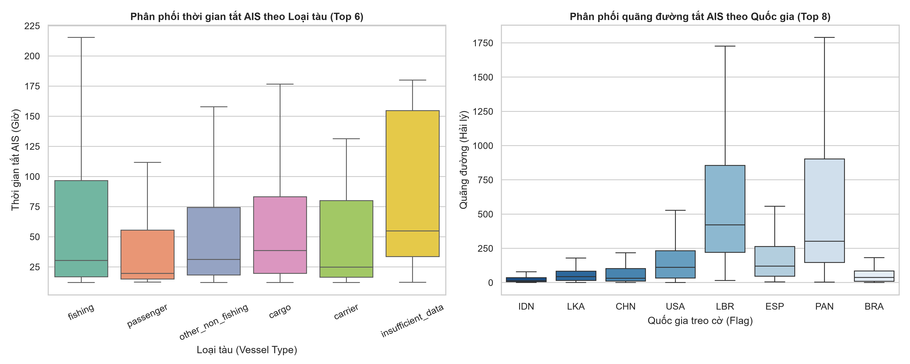
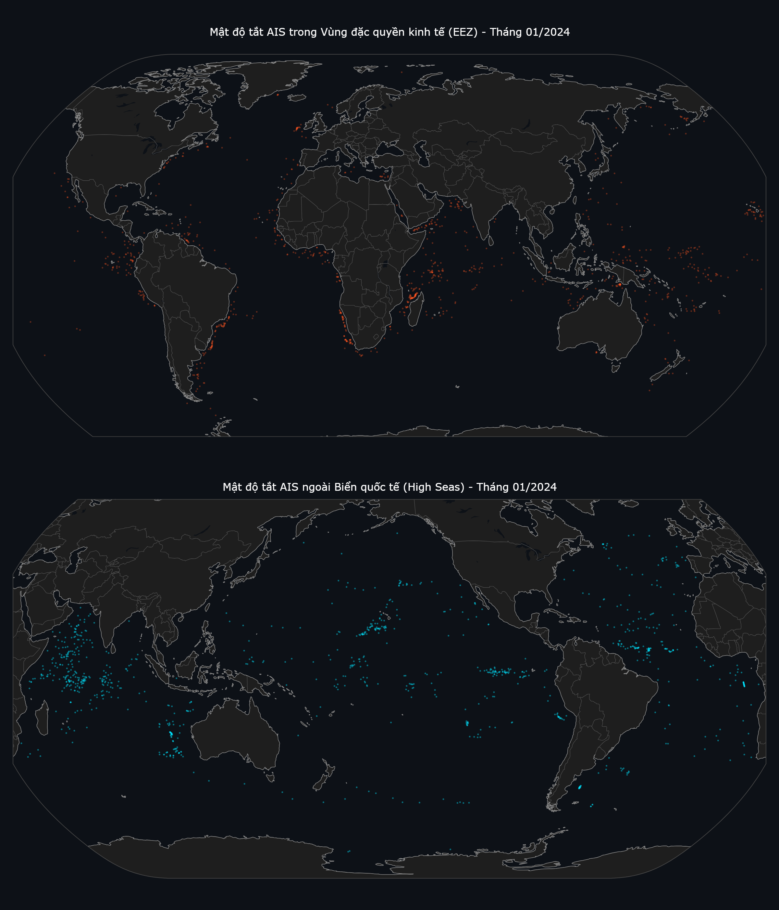

# AIS Gap Events from Global Fishing Watch, January 2024

This repository filters Global Fishing Watch (GFW) AIS gap events from **46,823 rows** down to **1,923 valid events** worldwide, then describes and visualises the filtered set. Every result can be reproduced with one Python script or one SQL statement.

## Input data

- Source: **Global Fishing Watch API v3** (`public-global-gaps-events:latest`), extracted with a Python script that uses a GFW API token.
- File: `events_raw_1.csv` (46,823 data rows, 42 columns), exported from GFW.
- Each row is **one AIS signal loss** (gap) already detected by GFW, not a raw ping sequence. Each gap lasts at least 12 hours.
- `vessel_ssvid` is used as the MMSI and must be read as a string so leading zeros are kept.
- Timestamps are ISO 8601 in UTC, for example `2017-01-04T23:22:58.000Z`.

## Filter funnel: 46,823 → 1,923

| Step | Condition | Remaining | Removed | % of raw |
|---|---|---|---|---|
| 1 | Raw data | 46,823 | – | 100.00% |
| 2 | `start` in January 2024 (2024-01-01 to 2024-01-31 inclusive, UTC) | 39,503 | 7,320 | 84.37% |
| 3 | Exclude `vessel_type = 'gear'` (buoys, fishing gear) | 2,167 | 37,336 | 4.63% |
| 4 | `vessel_ssvid` has 9 digits **and** does not start with `99` | 2,114 | 53 | 4.51% |
| 5 | `gap_impliedSpeedKnots <= 30` | 2,105 | 9 | 4.50% |
| 6 | `gap_durationHours <= 720` (30 days) | **2,021** | 84 | 4.32% |
| 7 | Exclude `vessel_ssvid` starting with `98` (auxiliary craft/buoys under ITU) | 1,974 | 47 | 4.22% |
| 8 | MID (first 3 digits of ssvid) in 201–775 (valid ITU MIDs) | **1,923** | 51 | 4.11% |

Step 6 gives the **2,021-row** set (the four original research filters). Steps 7 and 8 are extra identifier-quality rules following **ITU-R M.585** that bring the set to **1,923 rows**. They come from the `maritime-raw-data-audit` workflow. Removing these 98 rows cuts the number of rows missing a flag state (`vessel_flag`) from 107 to 9 (a 91.6% reduction). Both sets are kept so you can choose the one that matches your report.

The 1,923-row set contains 1,256 MMSI and 1,268 `vessel_id`.

## How to reproduce

### Step 0: Pull the data from the GFW API (optional)

Use `GFW_API_2024.py` to download `events_raw_1.csv` from the GFW Events API v3 (dataset `public-global-gaps-events:latest`). Create an API token in the GFW API portal and pass it through the environment variable `GFW_API_TOKEN`; the script never prints or saves the token.

```powershell
pip install -r requirements.txt
$env:GFW_API_TOKEN="your-token"            # macOS/Linux: export GFW_API_TOKEN="your-token"
python GFW_API_2024.py --start-date "2024-01-01T00:00:00.000Z" --end-date "2024-02-01T00:00:00.000Z" --out events_raw_1.csv
```

By default, the command downloads AIS gaps flagged with `intentionalDisabling = True` in the window from 2024-01-01 00:00 UTC to 2024-02-01 00:00 UTC (pass `--all-gaps` to disable the client-side `intentionalDisabling` filter). The script pages through the results, retries on HTTP 429 and temporary server errors (HTTP 5xx), removes duplicate `id`s, and writes the same 42 columns, in the same order, as `events_raw_1.csv`. Add `--save-json raw_pages.jsonl` to keep the untouched API pages.

Check the result: the file should contain **46,823** data rows, and every row should have `gap_intentionalDisabling = True`. A different count usually means a different date window or API data version than the original download, and the funnel below will then give different numbers.

### Option 1: Python (recommended)

```bash
pip install pandas
python reproduce_1923.py events_raw_1.csv gfw_clean_1923_global.csv
```

The script prints the 8-step funnel and saves `gfw_clean_1923_global.csv` and `funnel_46823_to_1923.csv`. It ends with an `assert` that the final row count equals 1,923, so it fails if the input data differ.

### Option 2: MySQL

1. Load the data with `load_events.sql` (it contains the `CREATE TABLE` for the 42 columns and a `LOAD DATA LOCAL INFILE` command). Enable `local_infile` and edit the file path. Do not use the Table Data Import Wizard for large files; it is very slow.
2. Check that `SELECT COUNT(*) FROM gap_events;` returns **46,823**.
3. Filter the 1,923-row set:

```sql
SELECT *
FROM gap_events
WHERE `start` >= '2024-01-01' AND `start` < '2024-02-01'
  AND vessel_type <> 'gear'
  AND vessel_ssvid REGEXP '^[0-9]{9}$'
  AND vessel_ssvid NOT LIKE '99%'
  AND vessel_ssvid NOT LIKE '98%'
  AND CAST(LEFT(vessel_ssvid, 3) AS UNSIGNED) BETWEEN 201 AND 775
  AND gap_impliedSpeedKnots <= 30
  AND gap_durationHours <= 720;
```

Remove the two conditions for `98` and the MID to get the 2,021-row set.

## Main results for the 1,923-row set

- **Vessel type:** `fishing` 1,194 (62.09%), `cargo` 349 (18.15%), `other_non_fishing` 254 (13.21%), `passenger` 75 (3.90%), `carrier` 27 (1.40%), `insufficient_data` 15 (0.78%), `seismic_vessel` 7 (0.36%), `support` 1 and `bunker` 1 (0.05% each). `vessel_type` has no missing values.
- **Top 10 flag states:** USA 163, CHN 160, IDN 124, LBR 113, LKA 89, BRA 88, PAN 83, ESP 82, TWN 77, MHL 64. 9 rows have no flag state.
- **Sea areas:** `high_seas` 939 events (48.83%), EEZ 918 (47.74%), a ratio of about 1.02 : 1; 66 rows (3.43%) belong to neither.
- **Distance from shore:** 100% of AIS-off start positions are at least 93 km from shore, but **385 events (20.02%)** ended (AIS came back on) within 92.6 km of shore.
- **Major FAO areas:** 51 (531 events, 27.61%), 77 (212), 71 (185), 87 (179; down 58 events after removing the 98 and non-standard MMSIs), 34 (154).
- **RFMO** (ACAP and IWC excluded because they cover almost the whole globe): IOTC 626, ICCAT 591, WCPFC 377, NAMMCO 315, CCSBT 285.
- **Descriptive statistics:**

| Metric | Mean | Q1 | Median | Q3 | Max |
|---|---|---|---|---|---|
| AIS-off duration (hours) | 86.76 | 17.05 | 32.08 | 88.74 | 719.95 |
| Displacement distance (nautical miles) | 299.19 | 24.83 | 102.23 | 302.46 | 6,104.46 |
| Implied speed (knots) | 4.51 | 0.67 | 2.33 | 8.04 | 22.24 |

Distance is computed as `gap_distanceKm / 1.852`.

## Visualisation





## Files in the repository

| File | Content |
|---|---|
| `GFW_API_2024.py` | Downloads the raw gap events from the GFW API into `events_raw_1.csv` |
| `requirements.txt` | Python dependencies for both scripts (`requests`, `pandas`) |
| `reproduce_1923.py` | Reproduces the 1,923-row set and the funnel table |
| `funnel_46823_to_1923.csv` | 8-step funnel table |
| `gfw_clean_1923_global.csv` | Clean set of 1,923 events, all 42 columns |
| `gfw_clean_2021_global.csv` | 2,021-event set (before the `98` and MID steps) |
| `gfw_clean_1923_descriptive_stats.csv` | Descriptive statistics of the 1,923-row set |
| `load_events.sql` | Creates the MySQL table and loads the data |
| `maritime_audit_scorecard.md`, `maritime_audit_flags.csv` | Quality scorecard and the 98 rows flagged in the 2,021-row set |
| `gfw_2024_01_charts.png`, `gfw_2024_01_world_map.png` | Figures 1 and 2 |

## Notes for interpretation

- **The data are gap events, not raw pings**, so GPS jumps between pings cannot be detected.
- **Sampling of the source file:** the download window was 2024-01-01 to 2024-02-01 (UTC). `start` only goes up to 2024-01-30 and the earliest `end` is 2024-01-01, which is consistent with the API returning every gap that overlaps that window (an inference from the data, not confirmed with GFW). This selection favours long gaps, so do not use this set to infer the typical AIS-off duration for a whole year.
- **Coastal cut-off:** all AIS-off start positions are at least 93 km from shore, consistent with the 50 nautical mile threshold GFW uses when detecting gaps. Events closer to shore are not in the data.
- **Low implied speed:** the median is only 2.33 kn, so many gaps may come from poor coverage or vessels at rest, not necessarily deliberate disabling.
- **Mostly empty columns:** `vessel_nextPort` is entirely empty; `vessel_flag` is missing for most of the raw table.

## Data source and copyright

The data belong to Global Fishing Watch (GFW) and were retrieved through the GFW Events API v3 for non-commercial research and analysis. To keep the repository small and comply with data-sharing rules, the raw file (`events_raw_1.csv`, about 27 MB) is not included; users can rebuild it with `GFW_API_2024.py`. Check GFW's terms of use and attribution requirements before publishing any data.
